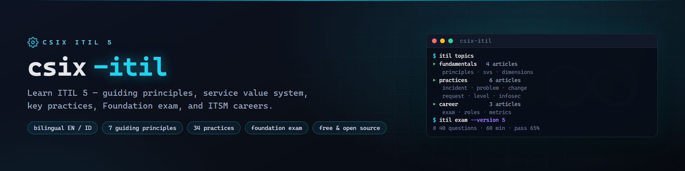

# csix-itil



**Basis belajar ITIL 5 dan IT service management gratis dua bahasa (EN/ID) — prinsip panduan, service value system, empat dimensi, praktik utama, ujian Foundation, dan karier ITSM.**

[](https://github.com/siedysoes/csix-itil/actions/workflows/ci.yml)
[](LICENSE)
[](https://siedysoes.github.io/csix-itil/)
[](https://www.peoplecert.org/browse-certifications/it-governance-and-service-management/ITIL-1)

`csix-itil` adalah basis pengetahuan yang terstruktur dan ramah pemula
untuk belajar ITIL dan IT service management (ITSM) — artikel pendek,
praktis, dan saling terhubung yang menjelaskan prinsip panduan framework,
praktik utamanya, dan cara kerja sertifikasi Foundation.

> ™️ **Sumber belajar independen.** ITIL adalah merek dagang terdaftar milik
> PeopleCert (yang mengakuisisi AXELOS pada 2021). Situs ini tidak berafiliasi
> dan tidak didukung PeopleCert — selalu konfirmasi silabus, format ujian, dan
> harga terkini di situs resmi PeopleCert.

> 🌐 **Baca di web:** **https://siedysoes.github.io/csix-itil/**

## Isi

### Fundamental (4 artikel)

| Artikel | Yang akan Anda pelajari |
|---------|-------------------------|
| [Apa Itu ITIL](id/fundamentals/what-is-itil.md) | Definisi, versi hingga ITIL 5, kenapa ITSM penting |
| [Prinsip Panduan](id/fundamentals/guiding-principles.md) | 7 prinsip panduan dan cara menerapkannya |
| [Service Value System](id/fundamentals/service-value-system.md) | Aktivitas value chain, opportunity & demand, value |
| [Empat Dimensi Service Management](id/fundamentals/four-dimensions.md) | People, value stream, teknologi, partner |

### Praktik Utama (6 artikel)

| Artikel | Yang akan Anda pelajari |
|---------|-------------------------|
| [Manajemen Insiden](id/practices/incident-management.md) | Memulihkan layanan cepat, triage, eskalasi, insiden mayor |
| [Manajemen Problem](id/practices/problem-management.md) | Akar masalah, known error, mencegah kejadian ulang |
| [Change Enablement](id/practices/change-enablement.md) | Jenis change, penilaian risiko, alur persetujuan |
| [Manajemen Service Request](id/practices/service-request-management.md) | Request vs insiden, alur fulfillment |
| [Manajemen Service Level](id/practices/service-level-management.md) | SLA, OLA, target level layanan dan review |
| [Manajemen Keamanan Informasi](id/practices/information-security-management.md) | CIA, kontrol, keamanan di dalam ITSM |

### Karier & Sertifikasi (3 artikel)

| Artikel | Yang akan Anda pelajari |
|---------|-------------------------|
| [Ujian ITIL Foundation](id/career/foundation-exam.md) | Format, nilai lulus, rencana belajar, hal yang perlu diverifikasi |
| [Peran & Karier ITSM](id/career/itsm-roles.md) | Peran, jalur karier, framework pelengkap |
| [Metrik & KPI](id/career/metrics-kpis.md) | CSF, KPI, pelaporan yang mendorong keputusan |

Setiap artikel tersedia dalam **English** (`en/`) dan **Bahasa Indonesia** (`id/`).

## Baca di web

Situsnya adalah aplikasi statis satu halaman (tanpa server, tanpa pelacakan)
yang dijalankan GitHub Pages — merender file Markdown dari repo ini secara langsung:

- 🌐 **https://siedysoes.github.io/csix-itil/**
- Tombol ganti bahasa **EN ↔ ID** di bar atas
- Kotak pencarian memfilter topik saat Anda mengetik
- Link di dalam artikel navigasi tanpa reload halaman

## Struktur repositori

```
csix-itil/
├── index.html        # cangkang aplikasi web
├── app.js            # router + pencarian + ganti bahasa
├── style.css         # tema gelap
├── topics.json       # manifest topik (judul + jalur, EN/ID)
├── assets/           # banner
├── en/               # artikel English
│   ├── fundamentals/
│   ├── practices/
│   └── career/
├── id/               # artikel Indonesia
│   ├── fundamentals/
│   ├── practices/
│   └── career/
└── .github/workflows # CI: validasi link + manifest
```

## Fakta ujian (verifikasi sebelum booking)

ITIL 5 adalah versi saat ini — PeopleCert mengumumkannya pada Januari 2026,
dan buku resminya *ITIL Foundation Global Best Practice* (edisi 5). Saat
artikel ini ditulis, ujian ITIL 5 Foundation berupa:

- 40 soal pilihan ganda dalam 60 menit, closed book, nilai lulus 65%
- Tersedia dalam beberapa bahasa; sertifikasi diperbarui tiap 3 tahun
  (60 poin CPD)

Framework memiliki 7 prinsip panduan dan 34 praktik. Format ujian, silabus,
dan harga paket bisa berubah — konfirmasi semuanya di
[peoplecert.org](https://www.peoplecert.org/) sebelum booking.

## Berkontribusi

1. Fork, lalu tambah/ubah Markdown di `en/` (dan terjemahkan di `id/`).
2. Daftarkan topik baru di `topics.json` (kedua bahasa).
3. Buka pull request — CI memastikan semua link dan entri manifest valid.

Gaya artikel: Markdown murni, tanpa front matter, baris pertama `# Judul`,
diakhiri satu bagian `## Lihat juga` berisi link relatif.

## Bahasa

- [English](README.md)
- Bahasa Indonesia (file ini)

## Lisensi

MIT — lihat [LICENSE](LICENSE). Konten bebas dipelajari, dibagikan, dan
diadaptasi dengan atribusi. ITIL adalah merek dagang terdaftar PeopleCert;
proyek ini adalah sumber belajar independen tidak resmi.
