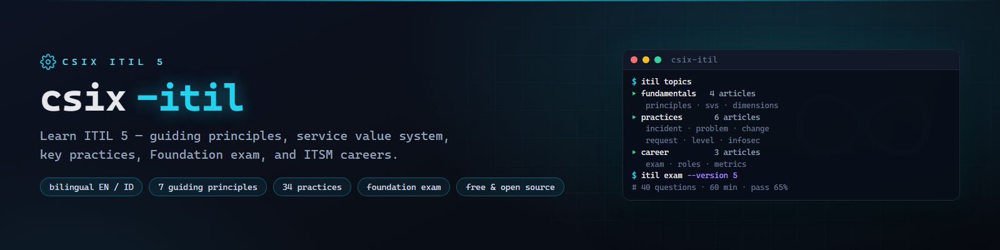

# csix-itil



**Free bilingual (EN/ID) ITIL 5 and IT service management learning base — guiding principles, the service value system, four dimensions, key practices, the Foundation exam, and ITSM careers.**

[](https://github.com/siedysoes/csix-itil/actions/workflows/ci.yml)
[](LICENSE)
[](https://siedysoes.github.io/csix-itil/)
[](https://www.peoplecert.org/browse-certifications/it-governance-and-service-management/ITIL-1)

`csix-itil` is a structured, beginner-friendly knowledge base for learning
ITIL and IT service management (ITSM) — short, practical, cross-linked
articles covering the framework's guiding principles, its key practices,
and how the Foundation certification works.

> ™️ **Independent study resource.** ITIL is a registered trademark of
> PeopleCert (which acquired AXELOS in 2021). This site is not affiliated
> with or endorsed by PeopleCert — always confirm the current syllabus,
> exam format, and prices on the official PeopleCert website.

> 🌐 **Read it on the web:** **https://siedysoes.github.io/csix-itil/**

## What's inside

### Fundamentals (4 articles)

| Article | You'll learn |
|---------|--------------|
| [What Is ITIL](en/fundamentals/what-is-itil.md) | Definition, versions up to ITIL 5, why ITSM matters |
| [Guiding Principles](en/fundamentals/guiding-principles.md) | The 7 guiding principles and how to apply them |
| [The Service Value System](en/fundamentals/service-value-system.md) | Value chain activities, opportunity & demand, value |
| [Four Dimensions of Service Management](en/fundamentals/four-dimensions.md) | People, value streams, technology, partners |

### Key Practices (6 articles)

| Article | You'll learn |
|---------|--------------|
| [Incident Management](en/practices/incident-management.md) | Restore service fast, triage, escalation, major incidents |
| [Problem Management](en/practices/problem-management.md) | Root cause, known errors, preventing recurrence |
| [Change Enablement](en/practices/change-enablement.md) | Change types, risk assessment, approval flows |
| [Service Request Management](en/practices/service-request-management.md) | Request vs incident, fulfillment workflows |
| [Service Level Management](en/practices/service-level-management.md) | SLAs, OLAs, service level targets and reviews |
| [Information Security Management](en/practices/information-security-management.md) | CIA, controls, security inside ITSM |

### Career & Certification (3 articles)

| Article | You'll learn |
|---------|--------------|
| [ITIL Foundation Exam](en/career/foundation-exam.md) | Format, passing score, study plan, what to verify |
| [ITSM Roles & Career](en/career/itsm-roles.md) | Roles, career paths, complementary frameworks |
| [Metrics & KPIs](en/career/metrics-kpis.md) | CSFs, KPIs, reporting that drives decisions |

Every article exists in **English** (`en/`) and **Indonesian** (`id/`).

## Read on the web

The site is a static single-page app (no server, no tracking) served by
GitHub Pages — it renders the Markdown files from this repo live:

- 🌐 **https://siedysoes.github.io/csix-itil/**
- Language toggle **EN ↔ ID** in the top bar
- Search box filters topics as you type
- In-article links navigate without page reloads

## Repository layout

```
csix-itil/
├── index.html        # web app shell
├── app.js            # router + search + language toggle
├── style.css         # dark theme
├── topics.json       # topic manifest (titles + paths, EN/ID)
├── assets/           # banner
├── en/               # English articles
│   ├── fundamentals/
│   ├── practices/
│   └── career/
├── id/               # Indonesian articles
│   ├── fundamentals/
│   ├── practices/
│   └── career/
└── .github/workflows # CI: link + manifest validation
```

## Exam facts (verify before you book)

ITIL 5 is the current version — PeopleCert announced it in January 2026,
and the official companion book is *ITIL Foundation Global Best Practice*
(5th edition). As of this writing, the ITIL 5 Foundation exam is:

- 40 multiple-choice questions in 60 minutes, closed book, pass mark 65%
- Delivered in multiple languages; certification renews every 3 years
  (60 CPD points)

The framework has 7 guiding principles and 34 practices. Exam formats,
syllabi, and bundle prices change — confirm everything on
[peoplecert.org](https://www.peoplecert.org/) before you book.

## Contribute

1. Fork and add/edit Markdown under `en/` (and translate under `id/`).
2. Register new topics in `topics.json` (both languages).
3. Open a pull request — CI checks that all links and manifest entries resolve.

Article style: pure Markdown, no front matter, `# Title` first line,
one `## See also` section with relative links at the end.

## Languages

- English (this file)
- [Bahasa Indonesia](README.id.md)

## License

MIT — see [LICENSE](LICENSE). Content is free to learn from, share, and adapt
with attribution. ITIL is a registered trademark of PeopleCert; this project
is an independent, unofficial study resource.
